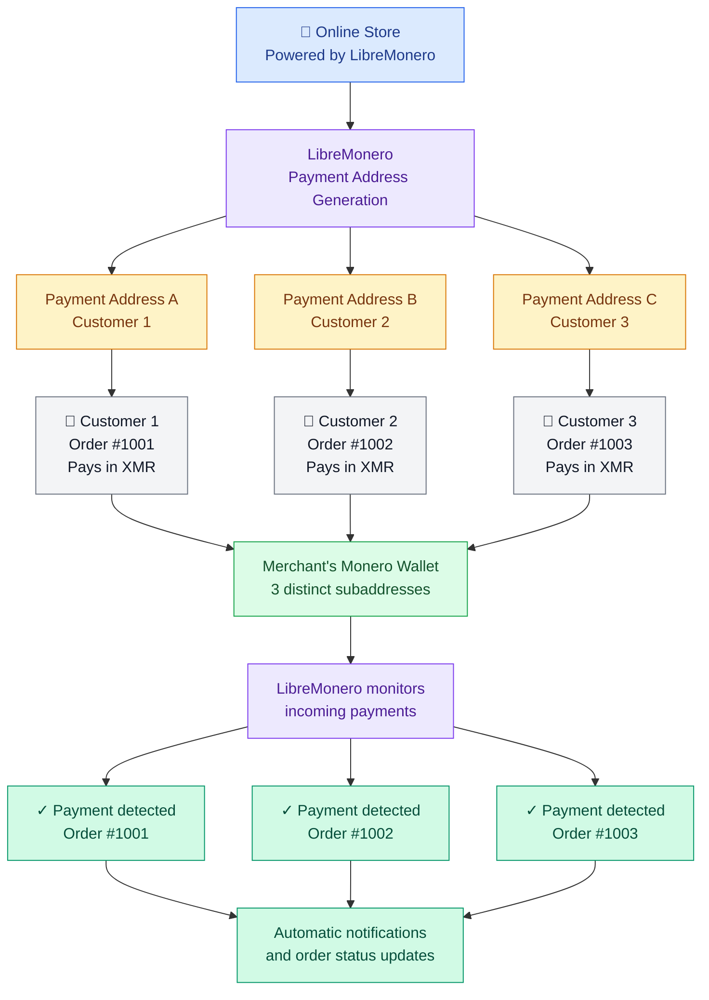

> [!IMPORTANT]
> **[LibreMonero](https://libremonero.com/)** is a service specializing in Monero (XMR) payment detection, designed to help merchants, developers, and content creators easily accept this cryptocurrency.

[ %>)](https://libremonero.com)

By leveraging view-only wallets and subaddress technology, LibreMonero makes it possible to identify incoming payments individually, without having to share private keys or entrust funds to a third party.

Its goal is simple: to make accepting Monero payments accessible to everyone, without complex infrastructure, servers to manage, or advanced technical knowledge.

LibreMonero presents itself as a professional, non-custodial, privacy-focused solution designed to facilitate the adoption of Monero in e-commerce.

{{toc}}

## Why LibreMonero?

Accepting cryptocurrency payments can quickly become complicated for merchants.

When a store uses a single Monero address to receive multiple payments, it can be difficult to determine which customer made a payment, especially when several transactions arrive within a short period of time.

LibreMonero addresses this issue by assigning a unique subaddress to each payment.

This approach makes it possible to:

- Associate each payment with a specific order.
- Distinguish transactions from different customers.
- Automatically check payment statuses.
- Easily integrate Monero payments into an online store.
- Receive automatic notifications when a payment is detected.

All this without giving LibreMonero the ability to spend the received funds.

## Technology Based on View-Only Wallets

One of LibreMonero's main advantages lies in its use of view-only wallets.

This type of wallet uses a view key that allows incoming transactions to be monitored without having access to the private key required to spend funds.

In practical terms, this means LibreMonero can detect payments received at generated subaddresses, but cannot transfer the XMR held in the wallet.

The private spend key and recovery seed remain exclusively under the user's control.

This architecture provides an important separation between payment monitoring and fund management.

## Subaddress Isolation

Subaddress management is at the core of how LibreMonero works.

In Monero, subaddresses make it possible to generate multiple receiving addresses associated with a single wallet.

LibreMonero leverages this feature to assign a distinct address to each transaction or order.

For example, an online store can generate:

- A first subaddress for order #1001.
- A second subaddress for order #1002.
- A third subaddress for order #1003.

When a payment arrives, the service can identify the corresponding subaddress and automatically associate the transaction with the correct order.

This isolation eliminates the ambiguity associated with using a single shared receiving address for multiple customers.

## Privacy and Financial Sovereignty

Privacy is a key priority in LibreMonero's design. The service highlights several safeguards and features:

- **No private key storage:** Keys that allow funds to be spent remain under the wallet owner's control.
- **Non-custodial wallet:** LibreMonero never takes possession of users' funds.
- **No KYC requirements:** According to the official website, no identity verification is required.
- **No mandatory registration:** The service claims users can get started without providing personal information.
- **No IP address logging:** LibreMonero states that it does not store IP addresses or browser fingerprints.
- **Control over funds:** Users retain full control of their wallets and recovery seeds.

This philosophy aligns with Monero's fundamental principles: privacy, financial autonomy, and censorship resistance.

## Performance Designed for Business Payments

LibreMonero advertises particularly fast payment detection times:

| Feature                      | Advertised Performance   |
| ---------------------------- | ------------------------ |
| Detection with the free plan | 5–10 seconds             |
| Detection with the Pro plan  | Approximately 3 seconds  |
| Supported network            | Monero Mainnet           |
| Notifications                | Webhooks                 |
| Subaddress generation        | Automatic via API        |
| Setup time                   | Approximately 10 minutes |

These performance levels make LibreMonero suitable for integration into online stores and various automated payment systems.

The advertised times refer to payment detection and do not constitute a guarantee of final transaction confirmation on the blockchain.

## Easy Setup for Everyone

Unlike some payment solutions that require a dedicated server, advanced technical configuration, and regular maintenance, LibreMonero aims to make the setup process as simple as possible.

The project advertises a setup time of around ten minutes, without requiring users to work with a terminal or manage a remote server.

This simplicity allows small businesses and non-technical users to start accepting Monero payments.

LibreMonero also offers an approach tailored to developers who want to integrate its features directly into their own applications.

## An API to Automate Payments

The full technical documentation is available on the official website: https://libremonero.com/docs

## What Can LibreMonero Be Used For?

LibreMonero is designed for a wide range of users.

### E-commerce

Online stores can integrate Monero payments into their checkout process.

Each customer receives a dedicated subaddress, making it easier to match incoming payments with their corresponding orders.

### Content Creators

Content creators can use LibreMonero to monetize their content, accept direct payments, or set up contribution systems.

The project specifically mentions Monero Feeder, which uses LibreMonero and a Mini POS system to monetize RSS feeds.

### Physical Stores

LibreMonero also plans to support physical retail businesses through a Mini POS system.

According to the official website, this feature is currently in development.

### Developers

Developers can leverage the API to build custom integrations, applications, and automated payment systems.

### CMS Extensions

The project also plans to develop extensions for content management systems and e-commerce platforms.

## A Free Plan to Get Started

LibreMonero offers a free plan aimed primarily at small businesses and individuals who want to try the service.

According to the information published on the official website, this plan includes:

- 20 payment detections per day.
- 300 payment detections per month.
- An advertised detection time of 5–10 seconds.
- Access to payment detection features.

A Pro plan is also available, with an advertised detection time of approximately 3 seconds.

For the latest terms and any pricing changes, users are advised to consult the official website directly.

## An Open-Source and Decentralized Philosophy

LibreMonero is built around the principles of digital sovereignty and financial freedom.

The project emphasizes a non-custodial approach, without relying on an intermediary capable of controlling funds or directly blocking transactions.

The website also announces a forthcoming open-source Community Edition under the AGPL license, along with the possibility of self-hosting.

This approach could give users greater transparency and more control over their payment infrastructure.

## Conclusion

LibreMonero offers an interesting approach to simplifying Monero payment acceptance.

By combining view-only wallets, subaddress isolation, and a dedicated API, the service aims to solve one of the main challenges merchants face: automatically identifying incoming payments without compromising the security of their funds.

Its simplified setup, free plan, and privacy-focused approach make it a solution worth considering for online stores, content creators, and developers looking to integrate Monero into their activities.

**LibreMonero aims to make professional Monero payments as easy to set up as a traditional payment system, while preserving the fundamental benefits of financial sovereignty.**

## Useful Links

- Official website: https://libremonero.com/
- API documentation: https://libremonero.com/docs
