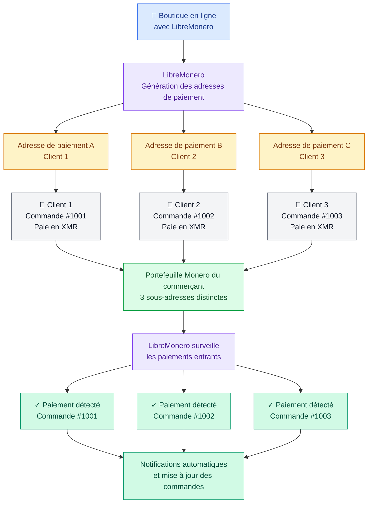

> [!IMPORTANT]
> **[LibreMonero](https://libremonero.com/)** est un service spécialisé dans la détection des paiements en Monero (XMR), conçu pour permettre aux commerçants, développeurs et créateurs de contenu d'accepter facilement cette cryptomonnaie.

[ %>)](https://libremonero.com)

Grâce à l'utilisation de portefeuilles en lecture seule et à la technologie des sous-adresses, LibreMonero permet d'identifier les paiements reçus individuellement, sans avoir besoin de communiquer ses clés privées ni de confier ses fonds à un intermédiaire.

Son objectif est simple : rendre l'acceptation des paiements en Monero accessible à tous, sans infrastructure complexe, sans serveur à administrer et sans connaissances techniques avancées.

LibreMonero se présente comme une solution professionnelle, non custodiale, respectueuse de la vie privée et conçue pour faciliter l'adoption de Monero dans le commerce en ligne.

{{toc}}

## Pourquoi LibreMonero ?

L'acceptation de paiements en cryptomonnaies peut rapidement devenir complexe pour un commerçant.

Lorsqu'une boutique utilise une seule adresse Monero pour recevoir plusieurs paiements, il peut être difficile de déterminer quel client a effectué un règlement, notamment lorsque plusieurs transactions arrivent dans un intervalle de temps rapproché.

LibreMonero répond à cette problématique en attribuant une sous-adresse spécifique à chaque paiement.

Cette approche permet notamment :

- D'associer chaque paiement à une commande précise.
- De distinguer les transactions de différents clients.
- De vérifier automatiquement le statut des paiements.
- D'intégrer facilement les paiements Monero dans un site marchand.
- De recevoir des notifications automatiques lors de la détection d'un paiement.

Le tout sans donner à LibreMonero la possibilité de dépenser les fonds reçus.

## Une technologie basée sur les portefeuilles en lecture seule

L'un des principaux atouts de LibreMonero repose sur son utilisation des portefeuilles en lecture seule.

Un portefeuille de ce type utilise une clé de consultation permettant de surveiller les transactions entrantes, sans disposer de la clé privée nécessaire pour dépenser les fonds.

Concrètement, cela signifie que LibreMonero peut détecter les paiements reçus sur les sous-adresses générées, mais ne peut pas transférer les XMR présents dans le portefeuille.

La clé privée de dépense et la phrase de récupération restent sous le contrôle exclusif de l'utilisateur.

Cette architecture apporte une séparation importante entre la surveillance des paiements et la gestion des fonds.

## L'isolation des sous-adresses

La gestion des sous-adresses constitue le cœur du fonctionnement de LibreMonero.

Dans Monero, les sous-adresses permettent de générer différentes adresses de réception associées à un même portefeuille.

LibreMonero exploite cette fonctionnalité pour attribuer une adresse distincte à chaque transaction ou commande.

Par exemple, une boutique en ligne peut générer :

- Une première sous-adresse pour la commande #1001.
- Une deuxième sous-adresse pour la commande #1002.
- Une troisième sous-adresse pour la commande #1003.

Lorsqu'un paiement arrive, le service peut identifier la sous-adresse concernée et associer automatiquement la transaction à la bonne commande.

Cette isolation évite les ambiguïtés liées à l'utilisation d'une adresse de réception commune pour plusieurs clients.

## Confidentialité et souveraineté financière

La confidentialité constitue une priorité dans la conception de LibreMonero. Le service met en avant plusieurs garanties et caractéristiques :

- **Aucune conservation des clés privées :** les clés permettant de dépenser les fonds restent sous le contrôle du propriétaire du portefeuille.
- **Portefeuille non custodial :** LibreMonero ne prend jamais possession des fonds.
- **Aucune procédure KYC :** aucune vérification d'identité n'est nécessaire selon le site officiel.
- **Aucune inscription obligatoire :** le service annonce permettre un démarrage sans fournir d'informations personnelles.
- **Absence de conservation des journaux IP :** LibreMonero indique ne pas conserver les adresses IP ni les empreintes web.
- **Contrôle des fonds :** les utilisateurs conservent la maîtrise de leurs portefeuilles et de leurs phrases de récupération.

Cette philosophie s'inscrit dans les principes fondamentaux de Monero : confidentialité, autonomie financière et résistance à la censure.

## Des performances adaptées aux paiements professionnels

LibreMonero annonce des délais de détection particulièrement courts :

| Fonctionnalité                  | Performance annoncée |
| ------------------------------- | -------------------- |
| Détection avec l'offre gratuite | 5 à 10 secondes      |
| Détection avec l'offre Pro      | Environ 3 secondes   |
| Réseau pris en charge           | Monero Mainnet       |
| Notifications                   | Webhooks             |
| Génération de sous-adresses     | Automatique via API  |
| Mise en place                   | Environ 10 minutes   |

Ces performances permettent d'envisager une intégration dans des boutiques en ligne et différents systèmes de paiement automatisés.

Les délais annoncés concernent la détection des paiements et ne constituent pas une garantie de confirmation définitive de la transaction sur la blockchain.

## Une installation accessible à tous

Contrairement à certaines solutions de paiement nécessitant un serveur dédié, une configuration technique avancée et une maintenance régulière, LibreMonero cherche à simplifier au maximum le processus d'installation.

Le projet annonce une mise en place en une dizaine de minutes, sans avoir besoin de manipuler un terminal ou d'administrer un serveur distant.

Cette simplicité permet notamment aux petites entreprises et aux utilisateurs non techniques de commencer à accepter des paiements en Monero.

LibreMonero propose également une approche adaptée aux développeurs souhaitant intégrer directement ses fonctionnalités dans leurs propres applications.

## Une API pour automatiser les paiements

La documentation technique complète est disponible sur le site officiel : https://libremonero.com/docs

## Pour quels usages ?

LibreMonero s'adresse à différents profils d'utilisateurs.

### Commerce électronique

Les boutiques en ligne peuvent intégrer les paiements en Monero dans leur processus de commande.

Chaque client dispose d'une sous-adresse dédiée, ce qui facilite le rapprochement entre les paiements reçus et les commandes correspondantes.

### Créateurs de contenu

Les créateurs peuvent utiliser LibreMonero pour monétiser leurs contenus, proposer des paiements directs ou mettre en place des systèmes de contribution.

Le projet mentionne notamment Monero Feeder, qui utilise LibreMonero et un système Mini POS pour la monétisation de flux RSS.

### Commerces physiques

LibreMonero prévoit également des possibilités d'utilisation dans les commerces physiques grâce à un système Mini POS.

Cette fonctionnalité est annoncée comme étant en préparation sur le site officiel.

### Développeurs

Les développeurs peuvent exploiter l'API pour construire des intégrations personnalisées, des applications et des systèmes automatisés de paiement.

### Extensions CMS

Le projet prévoit également le développement d'extensions destinées aux plateformes de gestion de contenu et aux boutiques en ligne.

## Une offre gratuite pour commencer

LibreMonero propose une offre gratuite destinée notamment aux petites entreprises et aux personnes souhaitant tester le service.

Selon les informations publiées sur le site officiel, cette offre comprend :

- 20 détections de paiements par jour.
- 300 détections de paiements par mois.
- Un délai de détection annoncé de 5 à 10 secondes.
- L'accès aux fonctionnalités de détection des paiements.

Une offre Pro est également mentionnée, avec un délai de détection annoncé d'environ 3 secondes.

Pour connaître les conditions et les éventuelles évolutions tarifaires, il est conseillé de consulter directement le site officiel.

## Une philosophie open source et décentralisée

LibreMonero s'inscrit dans une démarche de souveraineté numérique et de liberté financière.

Le projet met en avant une approche non custodiale, sans dépendance à un intermédiaire capable de contrôler les fonds ou de bloquer directement les transactions.

Le site annonce également une édition communautaire open source à venir, sous licence AGPL, ainsi qu'une possibilité d'hébergement autonome.

Cette orientation pourrait permettre aux utilisateurs de bénéficier d'une plus grande transparence et d'un meilleur contrôle de leur infrastructure de paiement.

## Conclusion

LibreMonero propose une approche intéressante pour simplifier l'acceptation des paiements en Monero.

En combinant les portefeuilles en lecture seule, l'isolation des sous-adresses et une API dédiée, le service cherche à résoudre l'un des principaux défis rencontrés par les commerçants : identifier automatiquement les paiements reçus sans compromettre la sécurité de leurs fonds.

Son installation simplifiée, son offre gratuite et son orientation vers la confidentialité en font une solution à considérer pour les boutiques en ligne, les créateurs de contenu et les développeurs souhaitant intégrer Monero à leurs activités.

**LibreMonero ambitionne de rendre les paiements professionnels en Monero aussi simples à mettre en place qu'un système de paiement traditionnel, tout en conservant les avantages fondamentaux de la souveraineté financière.**

## Liens utiles

- Site officiel : https://libremonero.com/
- Documentation API : https://libremonero.com/docs
